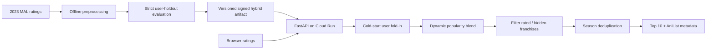

# Anime Taste DNA

[](https://github.com/Ruowen0613/anime-taste-dna/actions/workflows/ci.yml)

A deployed, end-to-end anime recommender that learns a new visitor's taste from explicit 1–10 ratings. Recommendations come from an offline-trained collaborative-filtering model—not an LLM—and are evaluated against a popularity baseline with leakage-safe cold-start splits.

**[Try the app](https://anime-taste-dna.vercel.app)** · **[API docs](https://anime-taste-dna-api-197238956100.northamerica-northeast2.run.app/docs)** · **[Health check](https://anime-taste-dna-api-197238956100.northamerica-northeast2.run.app/health)**

## What it does

- Presents 100 popular, model-supported anime in a compact rating grid so onboarding does not depend on remembering titles to search.
- Supports three-character type-ahead AniList search while keeping MyAnimeList ID as the canonical model identity.
- Uses up to 100 browser-local ratings for each recommendation request; users can sort, edit, remove, and inspect titles without an account.
- Produces a personalized Top 10 using a signed-rating hybrid, so both high and low ratings can change the ranking.
- Reduces popularity influence as the user supplies more evidence instead of applying one fixed global blend.
- Prevents multiple seasons of the same franchise from filling the Top 10.
- Treats **Not interested** as a hard title/franchise exclusion, managed through a collapsed card section in My Ratings rather than as a fabricated low score.
- Enriches cards and detail modals with AniList covers, genres, community scores, descriptions, and public review summaries.

## Recommendation pipeline



The production model keeps item parameters fixed and solves only a lightweight user representation at request time. Its ranking combines:

1. **Weighted ALS relevance** learned offline from high-confidence positive interactions.
2. **Signed explicit-rating residuals** centered around 5.5, allowing low ratings to push candidates away and high ratings to pull them closer.
3. **Popularity prior with rating-count decay**: `32 × min(1, 10 / mapped_ratings)`, so popularity matters most during cold start and falls as the profile grows.

Training never runs inside an API request. Historical user IDs and factors are excluded from the exported artifact; online inference receives only the current browser's ratings.

## Evaluation highlights

Model selection uses users who are completely absent from global embedding training. Validation selects parameters; the held-out test cohort is accessed only after choices are frozen. Candidate ranking covers the full train-supported catalog and excludes only interactions exposed to the model.

The signed hybrid fixed an important product failure: changing several high ratings to 1 previously left recommendations largely unchanged.

| Strict test model | Recall@10 | NDCG@10 | 10-rating coverage | Popularity overlap | High-to-low overlap |
|---|---:|---:|---:|---:|---:|
| Interaction-count popularity | 0.02720 | 0.56788 | 14 | 100% | 100% |
| Popularity-heavy Weighted ALS | 0.03012 | 0.60967 | 83 | 78.94% | 78.94% |
| Signed-rating hybrid | 0.02909 | 0.58537 | 249 | 68.09% | 7.71% |

The current `signed-rating-hybrid-v2` then adds rating-count-aware popularity decay. On its frozen 1,798-user strict test cohort it improved both accuracy and personalization over the same signed model with a fixed blend:

| Model | Mean Recall@10 | Mean NDCG@10 | Popularity overlap | 80-rating coverage |
|---|---:|---:|---:|---:|
| Fixed popularity blend | 0.02998 | 0.61060 | 69.76% | 96 |
| Dynamic popularity decay | **0.03021** | **0.61320** | **62.26%** | **189** |

At 80 ratings, popularity overlap fell from 73.40% to 51.91% while Recall@10 and NDCG@10 also increased. See [docs/EVALUATION.md](docs/EVALUATION.md) for protocols, full-precision results, rejected experiments, and limitations.

## Architecture

```text
frontend/             React 19, TypeScript, Vite, Tailwind CSS
backend/              FastAPI, Pydantic, NumPy, typed REST contracts
ml/                   PyTorch/pandas/scikit-learn training and evaluation
docs/                 Architecture, dataset, deployment, and evaluation evidence
.github/workflows/    Frontend/backend/ML CI and gated Cloud Run deployment
```

- **Frontend:** deployed to Vercel from protected `main`; ratings and exclusions remain in versioned local storage.
- **Backend:** one stateless FastAPI service on Google Cloud Run; AniList requests use connection pooling and bounded TTL caches.
- **Model artifact:** immutable, checksum-verified `signed-rating-hybrid-v2` stored privately in Google Cloud Storage and embedded into the backend image during release.
- **Identity:** MAL ID is canonical for model joins; AniList mappings are explicit. Runtime title matching is never used to join model items.
- **Delivery:** pull requests run frontend, backend, and ML checks. A successful CI run on `main` triggers keyless GitHub OIDC deployment to Cloud Run; Vercel deploys the frontend from the same branch.

More detail is available in [SPEC.md](SPEC.md), [docs/ARCHITECTURE.md](docs/ARCHITECTURE.md), and [docs/DEPLOYMENT.md](docs/DEPLOYMENT.md).

## Run locally

### Prerequisites

- Node.js 20.19+ (Node.js 22 recommended)
- Python 3.11+
- The versioned model artifact for recommendation and Popular Picks endpoints

### Backend

```bash
cd backend
python3 -m venv .venv
source .venv/bin/activate
python -m pip install -e '.[dev]'
uvicorn app.main:app --reload --port 8000
```

The backend expects the current artifact at:

```text
data/artifacts/signed-rating-hybrid-v2/signed_rating_hybrid.npz
```

Generated artifacts are intentionally Git-ignored. Follow [ml/README.md](ml/README.md) to reproduce/export the artifact, or set `MODEL_ARTIFACT_PATH` to an absolute compatible artifact path. Health and AniList search remain separate from offline training.

Open <http://localhost:8000/docs> for generated Swagger UI.

### Frontend

In another terminal:

```bash
cd frontend
npm install
cp ../.env.example .env.local
npm run dev
```

Open <http://localhost:5173>. The default API base URL is `http://localhost:8000`.

## Quality checks

```bash
# frontend
cd frontend
npm run lint
npm run typecheck
npm run build

# backend
cd ../backend
.venv/bin/ruff check .
.venv/bin/pytest

# ML
cd ../ml
python -m pip install -e '.[dev]'
ruff check .
pytest
```

## Core API

| Method | Endpoint | Purpose |
|---|---|---|
| `GET` | `/health` | Process health and model-independent availability |
| `GET` | `/api/v1/anime/search` | Sorted AniList type-ahead search with MAL mappings |
| `GET` | `/api/v1/anime/{anilist_id}` | Details, score, and public review summaries |
| `POST` | `/api/v1/anime/metadata` | Batch metadata for browser-local library cards |
| `GET` | `/api/v1/popular-picks` | 100 high-interaction titles supported by the model |
| `POST` | `/api/v1/recommendations` | Cold-start fold-in, ranking, filtering, and Top 10 enrichment |

## Dataset and reproducibility

The MVP uses the 2023 MyAnimeList User Ratings + Anime Dataset snapshot. Raw data, generated Parquet files, and model checkpoints are excluded from Git; deterministic configurations and sanitized reports are committed.

```bash
./scripts/download_myanimelist_2023_dataset.sh
```

See [docs/DATASET.md](docs/DATASET.md) for checksum, schema, filtering, and known limitations. The source snapshot ends in 2023, so newly released anime can be searched and rated in the product but cannot influence collaborative-filtering vectors until a future model artifact includes them.

## Deliberate MVP boundaries

- No authentication or database: ratings stay in the current browser.
- No online model retraining: only cold-start user fold-in runs per request.
- No LLM-generated recommendations.
- The experimental four-title Taste Quiz is hidden because its evaluated linear pairwise update did not improve ranking metrics.
- AniList outages degrade metadata and season-family filtering, but do not silently replace model ranking with generated recommendations.
